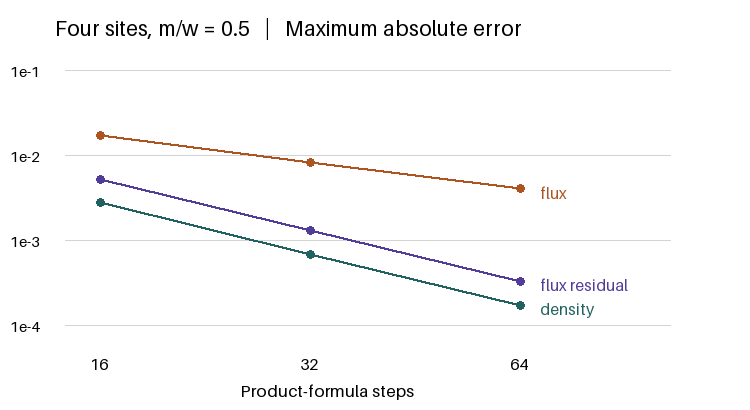
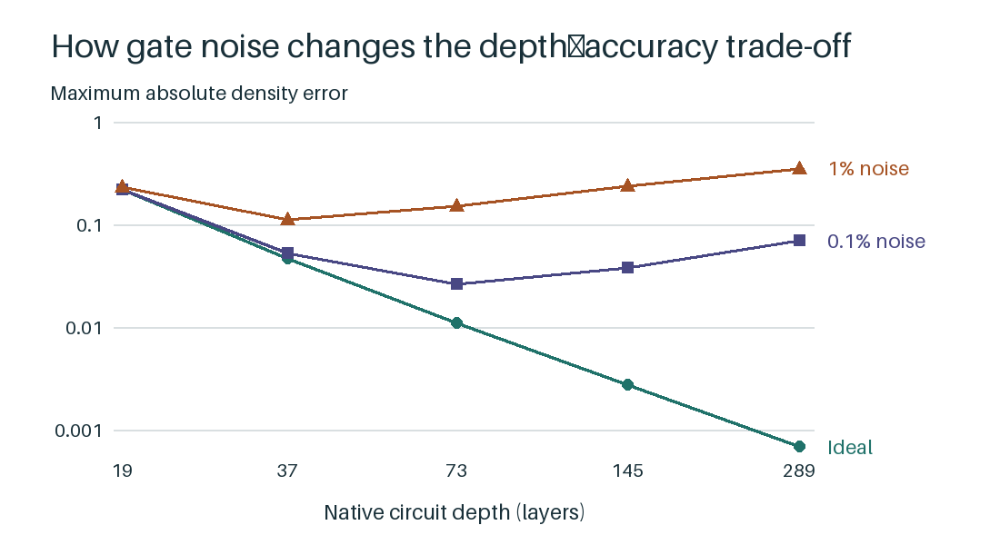

# Observable-dependent error in the lattice Schwinger model

Can a digital quantum simulation predict particle production accurately while missing a larger error in the local electric field? This study compares a simulated quantum circuit with exact evolution on four- and six-site lattices. Reflection symmetry suppresses the leading error in mean particle density for the ordered first-order circuit. Individual electric links can retain that error.

[Research report and references](schwinger-circuit-study/report.md) · [Simulation methods](schwinger-circuit-study/methods.md) · [Numerical results](schwinger-circuit-study/data)

## From a field theory to a measurable error

The Schwinger model describes charged matter coupled to an electric field in one spatial dimension. We start from an alternating vacuum configuration with zero electric flux at the boundaries. Hopping between neighboring sites can create a particle–antiparticle pair. Mean excitation density counts the excited sites, while the flux on each link records how charge is distributed along the chain.

We compute the exact evolution of this finite system by diagonalizing its Hamiltonian. A second calculation approximates the same evolution with a sequence of quantum gates. At each sampled time we compare the two predictions. For flux we report the largest absolute discrepancy on any link, because averaging over the chain can cancel errors of opposite signs.

## Why density converges faster than local flux

Reflecting the chain and flipping every spin preserves both the initial state and mean density. It also reverses the spatial order of the hopping gates. The leading error changes sign under this reversal, so it cancels for density. For flux the operation exchanges two mirror-image links, allowing either link to retain a leading error. We tested the predicted sign reversal on four and six sites at three masses. [Derivation and numerical checks](schwinger-circuit-study/report.md)



At four sites and mass-to-hopping ratio 0.5, increasing the step count from 32 to 64 reduced the maximum density error by a factor of 4.00 and the worst-link flux error by 2.04. The purple curve shows the flux error remaining after subtracting the commutator prediction. All results come from classical simulation.

## How much circuit depth helps under noise?



Each point gives the largest absolute density error across 20 nonzero times on four sites. Both axes use logarithmic scales. The noise percentage is the probability of applying a two-qubit depolarizing channel after each two-qubit rotation. At 0.1% noise, increasing depth from 73 to 289 raises the error from 0.0263 to 0.0696. For that same noise level, local flux reaches its smallest tested error at depth 145. The best depth therefore depends on which physical quantity the circuit must reproduce. [Full noise sweep]([data/depth_noise.csv](https://github.com/sajalfarooq/schwinger-model-trotter-error/blob/main/depth_noise.csv))

## Accuracy at comparable gate cost

On six sites, both circuits below fit a budget of 320 two-qubit rotations. The symmetric sequence uses more rotations per step, leaving room for fewer time steps.

| Ideal circuit | Steps | Two-qubit rotations | Maximum density error | Maximum link-flux error |
|---|---:|---:|---:|---:|
| First order | 16 | 320 | **0.002318** | 0.011086 |
| Symmetric second order | 8 | 312 | 0.007127 | **0.006380** |

These comparisons use open boundaries, finite lattices, and all-pairs connectivity. The error values describe this gate set and time window. Establishing hardware performance or quantum advantage would require a separate experiment. [Gate-budget data](schwinger-circuit-study/data/formula_comparison.csv)

## Reproduce the study

Use Python 3.12 in a virtual environment. From the repository root, run:

```sh
python -m pip install -r requirements.txt
python src/schwinger.py
python src/compare_formulas.py
python src/response_study.py
```

| Program | Outputs |
|---|---|
| Four-site exact evolution and gate noise | [Exact dynamics](schwinger-circuit-study/data/exact_dynamics.csv), [depth and noise sweep](data/depth_noise.csv) |
| First- and second-order comparison | [Two-qubit rotation budgets and observable errors](schwinger-circuit-study/data/formula_comparison.csv) |
| Leading-error prediction | [Response coefficients and residuals](data/response.csv), [convergence figure](schwinger-circuit-study/figures/convergence.png) |

The Python runs use deterministic state vectors and density matrices. They require no quantum hardware account. Optional [Wolfram Language scripts](wolfram/) provide a lattice check and a free-limit calculation. The latter requires FeynCalc.

Presented by **Sajal Farooq**, 7th semester student. [Download the research presentation](schwinger-circuit-study/Sajal-Farooq-Schwinger-study.pptx).

The [independent free-limit check](schwinger-circuit-study/src/check_free_limit.py) passed using explicit two-component Dirac matrices and exact Taylor coefficients. Run it with `python src/check_free_limit.py`. It verifies the mathematics of the optional FeynCalc example.

[Download the standalone Wolfram validation notebook](schwinger-circuit-study/wolfram/Schwinger-validation.nb). Its four-site reference data are embedded. A separate [neutral-sector Taylor calculation](schwinger-circuit-study/src/check_lattice.py) reproduced all 84 observable values with maximum absolute error 2.94e-15. Run `python src/check_lattice.py` to repeat the check.

## References

1. T. Banks, L. Susskind, and J. Kogut (1976). “Strong-coupling calculations of lattice gauge theories: (1 + 1)-dimensional exercises.” *Physical Review D* **13**, 1043. [DOI](https://doi.org/10.1103/PhysRevD.13.1043)
2. E. A. Martinez et al. (2016). “Real-time dynamics of lattice gauge theories with a few-qubit quantum computer.” *Nature* **534**, 516–519. [DOI](https://doi.org/10.1038/nature18318)
3. A. M. Childs, Y. Su, M. C. Tran, N. Wiebe, and S. Zhu (2021). “Theory of Trotter Error with Commutator Scaling.” *Physical Review X* **11**, 011020. [DOI](https://doi.org/10.1103/PhysRevX.11.011020)
4. N. H. Nguyen et al. (2022). “Digital Quantum Simulation of the Schwinger Model and Symmetry Protection with Trapped Ions.” *PRX Quantum* **3**, 020324. [DOI](https://doi.org/10.1103/PRXQuantum.3.020324)
