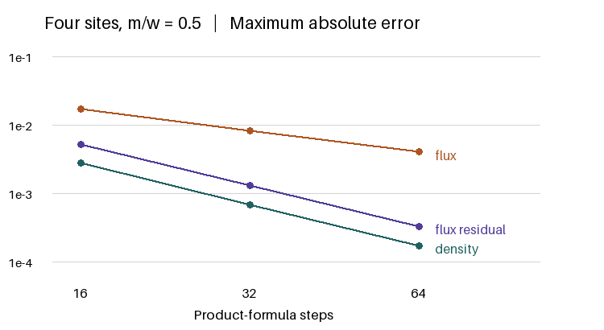

# When a first-order quantum circuit gives second-order accuracy
## Observable-dependent error in the lattice Schwinger model

### Abstract

How accurately can a quantum circuit simulate real-time particle production in a simple gauge theory? We studied the massive Schwinger model on open chains of four and six sites. At comparable two-qubit gate budgets, a first-order product formula gave smaller errors in mean excitation density, while a symmetric second-order formula gave smaller worst-link electric-flux errors at the two budgets examined. A symmetry of the neutral staggered vacuum explains why the density loses its leading discretization error. A commutator calculation independently predicts the signed leading flux error. Tests at three masses support both predictions. Separate four-site noise simulations show how increasing depth can erase the accuracy gained by smaller time steps.

### Physical problem and evidence

Banks, Susskind, and Kogut studied the massive Schwinger model on a spatial lattice using a strong-coupling expansion [1]. Martinez and colleagues later measured particle production from a bare vacuum on a trapped-ion device. Their four-site experiment supplies the physical setup and the ratios J/w = 1 and m/w = 0.5 for our central comparison. The calculations below use exact classical evolution as the reference. We use the paper for model and parameter correspondence. A pointwise experimental-data comparison lies outside the evidence presented here. The benchmark parameters come from Fig. 2(a) of Ref. [2].

Set w = 1. With one-based staggered sites, define charge q_j = [Z_j + (-1)^j]/2 and link flux L_j as the sum of charges through site j. The left boundary flux is zero. The Hamiltonian contains mass (m/2)Σ(-1)^j Z_j, electric energy JΣL_j², and hopping Σ(XX + YY)/2 on neighboring sites. The vacuum has zero charge at every site. The excitation density ν is the average of [1 + (-1)^j Z_j]/2 over all sites. It counts both members of each produced pair [2].

As an analytical check, there are N−1 distinct single-hop states reachable from the bare vacuum. Each has two excited sites and probability t² to leading order. Thus ν(t) = 2(N−1)t²/N + O(t⁴). Time-reversal invariance of the real Hamiltonian and diagonal observable makes the odd powers vanish. At four sites and t = 0.1 the quadratic prediction is 0.015, compared with 0.014834 from diagonalization.

### Why the measured observable matters

Write one first-order step as a diagonal phase followed by a left-to-right sweep of hopping gates. On each bond XX and YY commute, so their product implements the bond hopping exactly. Compare this schedule with its reverse. Reversing a first-order formula flips the sign of its leading effective-Hamiltonian correction. For gates applied in chronological order with generators h₁,…,hₛ, it is

    H_eff = H + δ K + O(δ²),     K = −(i/2) Σ_{a>b} [h_a,h_b],     δ = t/r.

This follows by expanding the logarithm of one step through second order. Commutator-based error theory provides wider context for this calculation [3].

There is also a physical way to reverse the sweep. Reflect the chain and flip every spin. For even N this leaves the staggered vacuum, mass term, and mean density invariant. Charge changes sign and reverses order. Since total charge is zero, the cumulative flux on link j maps to the flux on link N−j. The electric energy is therefore invariant in this sector. Hopping gates reverse their spatial order. The diagonal phase still occurs first, but moving it to the end conjugates the repeated evolution by a diagonal unitary. This changes neither diagonal measurements nor the initial basis-state projector.

Consequently the forward and reversed formulas give the same mean density. Their linear errors have opposite signs, so that coefficient must vanish. For a single link the same argument relates two different measurements. The linear errors on mirrored links must be equal and opposite. The center link is its own mirror, so its linear error must also vanish. This argument assumes ideal gates and this ordered splitting. It makes no assertion about arbitrary noise channels.

### Testing the prediction independently of a convergence fit

We diagonalized H, differentiated exp[−it(H+εK)] at ε = 0 using the divided difference of the exponential, and multiplied the resulting observable derivative by t/r. This predicts the signed error at each time without fitting circuit output. We separately propagated the gate sequence on a state vector. Maxima below cover 81 points from t = 0 to 2. The flux residual is the maximum after subtracting the signed prediction at each time and link.

| Steps | Density error | Worst-link flux error | Flux residual |
|---:|---:|---:|---:|
| 16 | 0.002739 | 0.017115 | 0.005192 |
| 32 | 0.000683 | 0.008213 | 0.001304 |
| 64 | 0.000171 | 0.004022 | 0.000326 |

At four sites and m = 0.5, doubling steps from 32 to 64 reduces the density error by a factor of 4.00 and the flux error by 2.04. Subtracting the predicted flux term restores a factor of 4.00. Across N = 4, 6 and m = 0, 0.5, 1, the largest computed magnitude of the density's linear coefficient was below 10⁻¹⁵. The corresponding worst-link coefficients ranged from 0.148 to 0.817. Mirrored coefficients summed to zero within the 10⁻¹¹ numerical test at every sampled time. These deterministic checks concern rounding and discretization. They carry no experimental confidence interval.

### Gate budget and noise

Nguyen and colleagues investigated how gate ordering, step size, and device imperfections affect trapped-ion Schwinger-model simulations with up to six qubits [4]. Here we compare the errors of two observables at a common rotation budget.

At six sites, 320 first-order two-qubit rotations gave density error 0.002318 and flux error 0.011086. A symmetric circuit using 312 rotations gave 0.007127 and 0.006380 respectively. The four-site comparison at 144 versus 136 rotations had the same ordering. Suppression of the linear density error explains how the cheaper first-order step can compete on density. The actual winner also depends on the remaining quadratic coefficients, the time window, and the integer step counts.

In the four-site noise study, after each two-qubit rotation we replaced the addressed pair by the maximally mixed state with probability p, retaining the reduced state of the other sites. The density-error minimum over the five tested depths moved from 289 at p = 0 to 73 at p = 0.001 and 37 at p = 0.01. At p = 0.001 flux favored depth 145. These counts assume all-pairs connectivity and native Pauli rotations. The noise sweep used 20 nonzero times and first-order circuits. Its minima are specific to that grid and synthetic channel.

### Conclusion and scope

A digital circuit can reproduce two physical observables of this finite gauge theory to measurable accuracy. Which circuit is economical depends on the symmetry of the observable and on noise. The calculations identify a case where using global density alone hides a larger local-field error. The modeled field theory has one spatial dimension, finite lattice spacing, and zero boundary field. Hardware performance, a continuum extrapolation, QCD, and computational advantage each require additional evidence.

### Reproduction

Tested with Python 3.12.14, NumPy 2.3.5, and Pillow 13.0.0. From the project directory run:

    python schwinger.py
    python compare_formulas.py
    python response_study.py

The first program writes exact dynamics and the noise sweep. The second writes the ideal formula comparison. The third writes all 18 response calculations and renders the convergence figure. All simulations are deterministic. The optional Wolfram scripts are independent validation materials and have not been executed in this environment.

### References

1. T. Banks, L. Susskind, and J. Kogut (1976). “Strong-coupling calculations of lattice gauge theories: (1 + 1)-dimensional exercises.” *Physical Review D* **13**, 1043. [DOI](https://doi.org/10.1103/PhysRevD.13.1043)
2. E. A. Martinez et al. (2016). “Real-time dynamics of lattice gauge theories with a few-qubit quantum computer.” *Nature* **534**, 516–519. [DOI](https://doi.org/10.1038/nature18318)
3. A. M. Childs, Y. Su, M. C. Tran, N. Wiebe, and S. Zhu (2021). “Theory of Trotter Error with Commutator Scaling.” *Physical Review X* **11**, 011020. [DOI](https://doi.org/10.1103/PhysRevX.11.011020)
4. N. H. Nguyen et al. (2022). “Digital Quantum Simulation of the Schwinger Model and Symmetry Protection with Trapped Ions.” *PRX Quantum* **3**, 020324. [DOI](https://doi.org/10.1103/PRXQuantum.3.020324)
