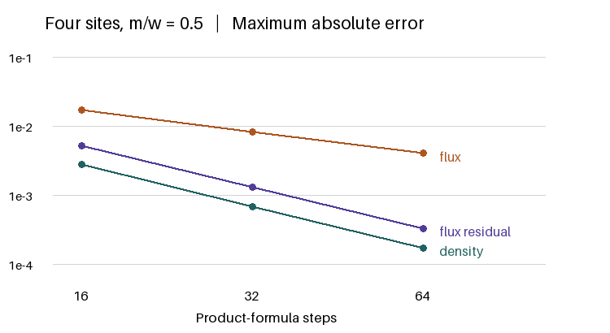

# Observable-dependent error in the lattice Schwinger model

Can a digital quantum simulation predict particle production accurately while missing a larger error in the local electric field? This study compares a simulated quantum circuit with exact evolution on four- and six-site lattices. Reflection symmetry suppresses the leading error in mean particle density for the ordered first-order circuit. Individual electric links can retain that error.

[Research report and references](report.md) · [Simulation methods](methods.md) · [Numerical results](data/)



At four sites and mass-to-hopping ratio 0.5, increasing the step count from 32 to 64 reduced the maximum density error by a factor of 4.00 and the worst-link flux error by 2.04. The purple curve shows the flux error remaining after subtracting the commutator prediction. All results come from classical simulation.

## Reproduce the study

Use Python 3.12 in a virtual environment. From the repository root, run:

```sh
python -m pip install -r requirements.txt
python src/schwinger.py
python src/compare_formulas.py
python src/response_study.py
```

| Program | Outputs |
|---|---|
| Four-site exact evolution and gate noise | [Exact dynamics](data/exact_dynamics.csv), [depth and noise sweep](data/depth_noise.csv) |
| First- and second-order comparison | [Two-qubit rotation budgets and observable errors](data/formula_comparison.csv) |
| Leading-error prediction | [Response coefficients and residuals](data/response.csv), [convergence figure](figures/convergence.png) |

The Python runs use deterministic state vectors and density matrices. They require no quantum hardware account. Optional [Wolfram Language scripts](wolfram/) provide a lattice check and a free-limit calculation. The latter requires FeynCalc.

Presented by **Sajal Farooq**, 7th semester student. [Download the research presentation](Sajal-Farooq-Schwinger-study.pptx).

The [independent free-limit check](src/check_free_limit.py) passed using explicit two-component Dirac matrices and exact Taylor coefficients. Run it with `python src/check_free_limit.py`. It verifies the mathematics of the optional FeynCalc example.

[Download the standalone Wolfram validation notebook](wolfram/Schwinger-validation.nb). Its four-site reference data are embedded. A separate [neutral-sector Taylor calculation](src/check_lattice.py) reproduced all 84 observable values with maximum absolute error 2.94e-15. Run `python src/check_lattice.py` to repeat the check.
